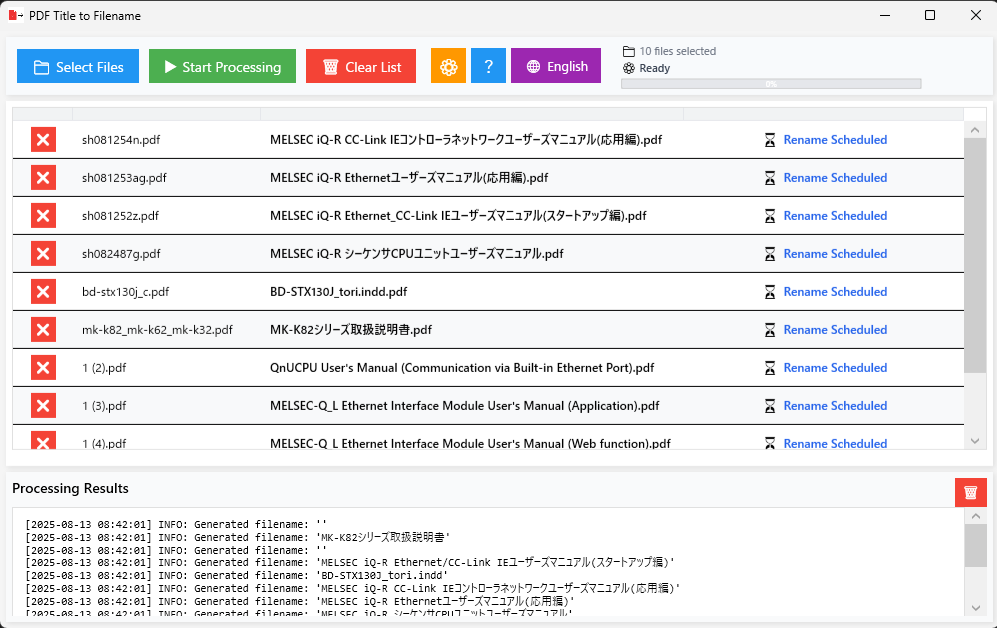
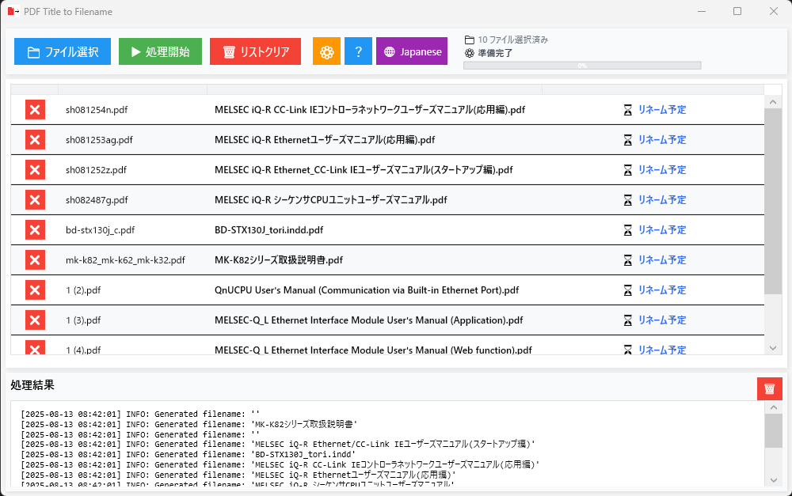

# PDF Title to Filename

[](https://github.com/fa-yoshinobu/PDF_Title_to_Filename/releases/latest)
[](https://github.com/fa-yoshinobu/PDF_Title_to_Filename/actions/workflows/static-analysis.yml)
[](https://github.com/fa-yoshinobu/PDF_Title_to_Filename/actions/workflows/release.yml)
[](https://github.com/fa-yoshinobu/PDF_Title_to_Filename/blob/main/LICENSE)
[](https://dotnet.microsoft.com/download/dotnet/8.0)

**English | [日本語](#日本語)**

PDF Title to Filename is a Windows WPF app that reads PDF metadata and renames PDF files with meaningful filenames. It supports batch processing, drag and drop, filename previews, Japanese/English UI, and configurable filename parts.



## Highlights

- Batch rename PDF files from metadata such as title, author, subject, and keywords.
- Combine metadata with the original filename, a custom prefix, or a custom suffix.
- Preview generated filenames before renaming.
- Drop files or folders; folders are scanned recursively for PDF files.
- Avoid duplicate names by appending `(1)`, `(2)`, and so on.
- Switch the UI language between English and Japanese.
- Publish as a single self-contained Windows executable.

## Filename Rules

Filename generation is controlled in the settings window.

- Enabled filename elements are evaluated in the order shown in settings.
- Empty metadata values are skipped.
- If every enabled value is empty, the file is treated as `No Metadata`.
- Enabled values are joined with the configured separator.
- Invalid Windows filename characters are replaced with `_`.
- Repeated whitespace is collapsed to one space and leading/trailing whitespace is trimmed.
- Empty sanitized names fall back to `Untitled`.
- Windows reserved names such as `CON` and `PRN` are prefixed with `_`.
- Names are trimmed to 240 characters before `.pdf` is added.

### NFKC Normalization

NFKC normalization converts full-width alphanumeric characters to half-width characters where it is safe to do so.

| Filename element | NFKC |
| --- | --- |
| Title | Enabled |
| Author | Enabled |
| Subject | Enabled |
| Keywords | Enabled |
| Original filename | Disabled |
| Custom prefix | Disabled |
| Custom suffix | Disabled |

Normalization is applied per filename element before the parts are joined. Metadata that contains the separator text is preserved as one element.

## Settings File

The settings file is `PDF_Title_to_Filename.json`.

The app first tries to save it next to the executable. If that is not writable, it falls back to:

```text
%TEMP%\PDF_Title_to_Filename_settings.json
```

Invalid or unreadable settings files fall back to the default settings.

## Build

```bat
build.bat
```

Output:

```text
artifacts\publish\PDF_Title_to_Filename.exe
```

## Local CI

```bat
ci.bat
```

`ci.bat` runs restore, tests, and a publish smoke test.

## Development

Requirements:

- Windows
- .NET 8 SDK

Useful commands:

```bat
dotnet restore
dotnet build --configuration Debug
dotnet test PDF_Title_to_Filename.sln --configuration Release
dotnet publish PDF_Title_to_Filename\PDF_Title_to_Filename.csproj --configuration Release
```

## Main Dependencies

| Library | Purpose |
| --- | --- |
| UglyToad.PdfPig | PDF metadata extraction |
| Microsoft.Extensions.DependencyInjection | Dependency injection |
| Microsoft.Extensions.Logging | Logging |
| System.Text.Encoding.CodePages | Additional encoding support |

## License

This project is licensed under the MIT License. See [LICENSE](LICENSE).

---

# 日本語

PDF Title to Filename は、PDF のメタデータを読み取り、わかりやすいファイル名へ一括リネームする Windows WPF アプリです。ドラッグ&ドロップ、リネーム前プレビュー、日本語/英語 UI、ファイル名構成のカスタマイズに対応しています。



## 主な機能

- PDF の Title / Author / Subject / Keywords からファイル名を生成
- 元ファイル名、任意の接頭辞、任意の接尾辞を組み合わせ可能
- リネーム前に生成予定のファイル名をプレビュー
- ファイルまたはフォルダのドラッグ&ドロップ対応
- フォルダ内の PDF を再帰的に検索
- 重複ファイル名には `(1)`, `(2)` のような連番を付与
- 日本語/英語 UI の切り替え
- 単一の自己完結型 Windows exe として配布可能

## ファイル名生成ルール

ファイル名の生成内容は設定ウィンドウで変更できます。

- 有効なファイル名要素を、設定画面の順序どおりに評価します。
- 空のメタデータはスキップします。
- 有効な値がすべて空の場合は `No Metadata` として扱います。
- 有効な値を設定済みセパレータで結合します。
- Windows のファイル名禁止文字は `_` に置換します。
- 連続空白は 1 つにまとめ、前後の空白を削除します。
- サニタイズ後に空になった場合は `Untitled` にします。
- `CON` や `PRN` などの Windows 予約語は先頭に `_` を付けます。
- `.pdf` を付ける前に 240 文字へ切り詰めます。

### NFKC 正規化

NFKC 正規化は、全角英数字などを半角へ変換する処理です。変換してよい要素にだけ適用します。

| ファイル名要素 | NFKC |
| --- | --- |
| Title | 有効 |
| Author | 有効 |
| Subject | 有効 |
| Keywords | 有効 |
| 元ファイル名 | 無効 |
| 接頭辞 | 無効 |
| 接尾辞 | 無効 |

正規化はファイル名要素ごとに行い、その後でセパレータ結合します。メタデータ内にセパレータ文字列が含まれていても、1 つの要素として保持します。

## 設定ファイル

設定ファイル名は `PDF_Title_to_Filename.json` です。

アプリはまず実行ファイルと同じフォルダへ保存を試みます。保存できない場合は次の場所へフォールバックします。

```text
%TEMP%\PDF_Title_to_Filename_settings.json
```

設定ファイルが壊れている、または読み込めない場合は既定設定を使用します。

## ビルド

```bat
build.bat
```

出力先:

```text
artifacts\publish\PDF_Title_to_Filename.exe
```

## ローカル CI

```bat
ci.bat
```

`ci.bat` は restore、テスト、publish smoke test を実行します。

## 開発

必要なもの:

- Windows
- .NET 8 SDK

よく使うコマンド:

```bat
dotnet restore
dotnet build --configuration Debug
dotnet test PDF_Title_to_Filename.sln --configuration Release
dotnet publish PDF_Title_to_Filename\PDF_Title_to_Filename.csproj --configuration Release
```

## 主な依存ライブラリ

| ライブラリ | 用途 |
| --- | --- |
| UglyToad.PdfPig | PDF メタデータ抽出 |
| Microsoft.Extensions.DependencyInjection | 依存性注入 |
| Microsoft.Extensions.Logging | ログ |
| System.Text.Encoding.CodePages | 追加エンコーディング対応 |

## ライセンス

このプロジェクトは MIT License です。詳細は [LICENSE](LICENSE) を参照してください。
